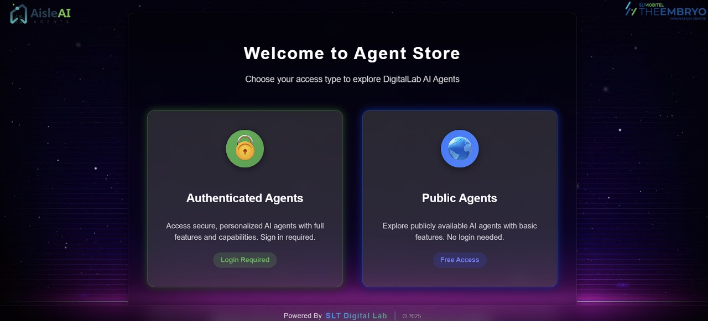
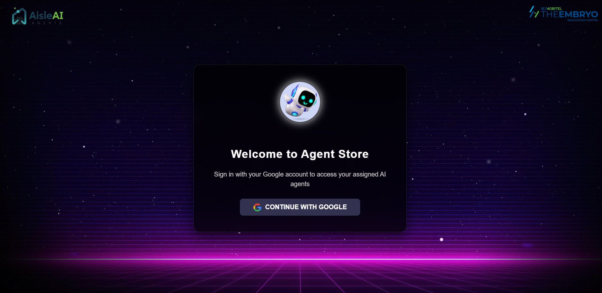
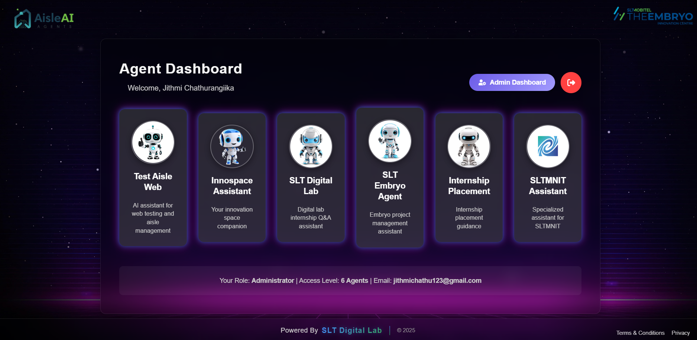
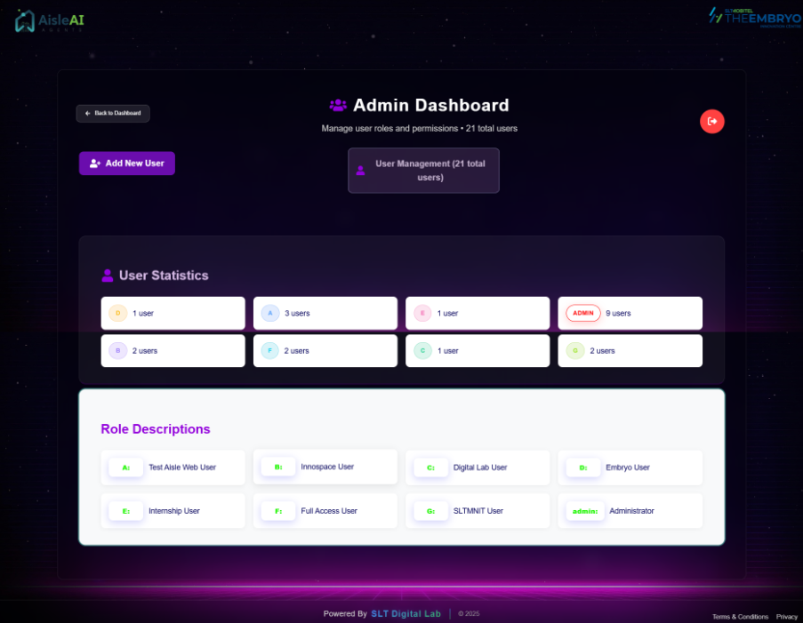
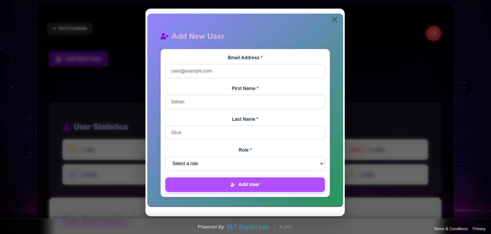
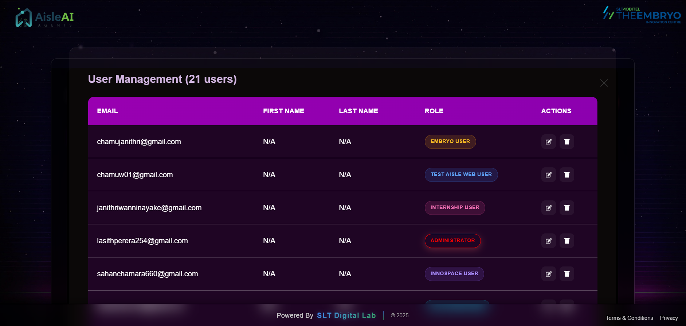
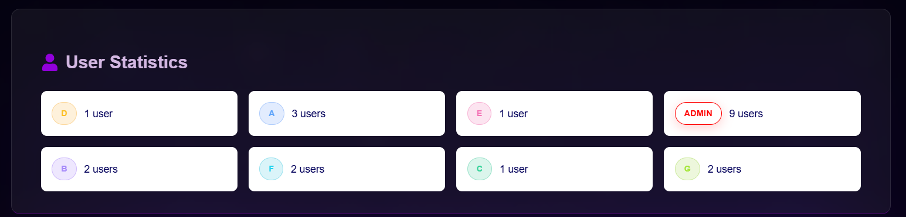
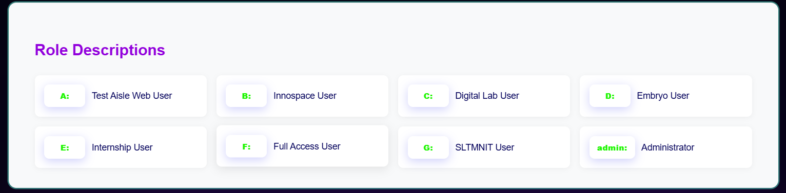

## Authenticated Agents Manual

This section provides step-by-step guidance for signed-in users to access and use **Authenticated Agents** within the Agent Store. These agents offer advanced capabilities and personalized AI support tailored to user roles and organizational functions.

---

- Visit the Agent Store at: `https://aisleaiagents.sltdigitallab.lk`

### Accessing Authenticated Agents

- From the home page, click on the **"Authenticated Agents"**.

**Step-01**  

  

---

### Sign In with Google

- Click on the **"Continue with Google"** button at the top-right of the navigation bar.

**Step-02**  

  

- Choose your Google account and complete the login process.

---

### Authenticated Agent Dashboard

Once signed in, you’ll be redirected to the **Authenticated Agents Dashboard**, where all available agents are listed.

Currently available authenticated agents:

1. **Test Aisel Web** – AI for web testing & aisle management  
2. **Innospace Assistant** – Innovation companion  
3. **SLT Digital Lab** – Internship Q&A bot  
4. **ALT Embryo Agent** – Embryo project coordination assistant  
5. **Internship Placement** – Internship placement guide  
6. **SLTMNIT Assistant** – SLTMNIT-specific support agent  

**Step-03**  

  

Users can interact with each agents.

### Interacting with Admin Dashboard

- From the Authenticated Agents Dashboard, click on the "Admin Dashboard" card to navigate to the admin control panel.

- Only users with the Administrator role can access this section.

- The Admin Dashboard allows full control over user management and role assignments.

  

#### Admin Features

- Add New Users: Create users with specific roles such as Developer, Intern, Moderator, etc.

  

- Edit/Delete Users: Modify user details or remove accounts.

  

- User Statistics: View total number of users from each role.

  

- Role Descriptions: Available Roles

  
