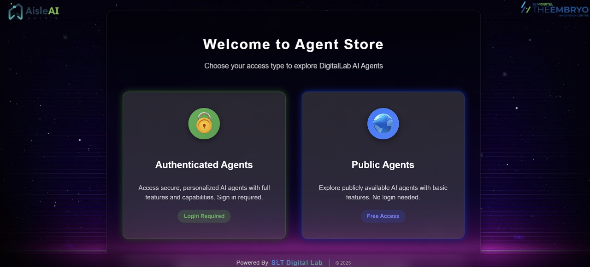
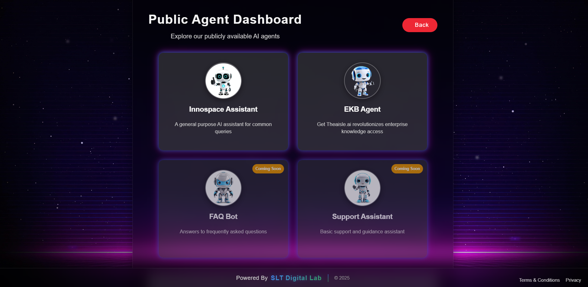
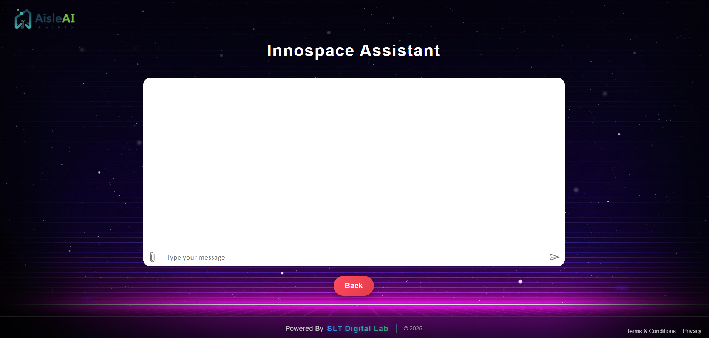
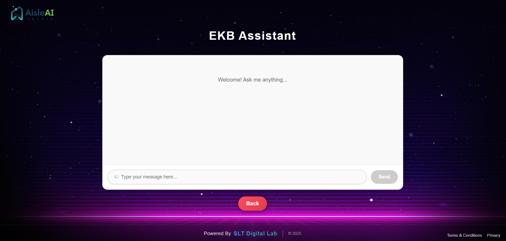
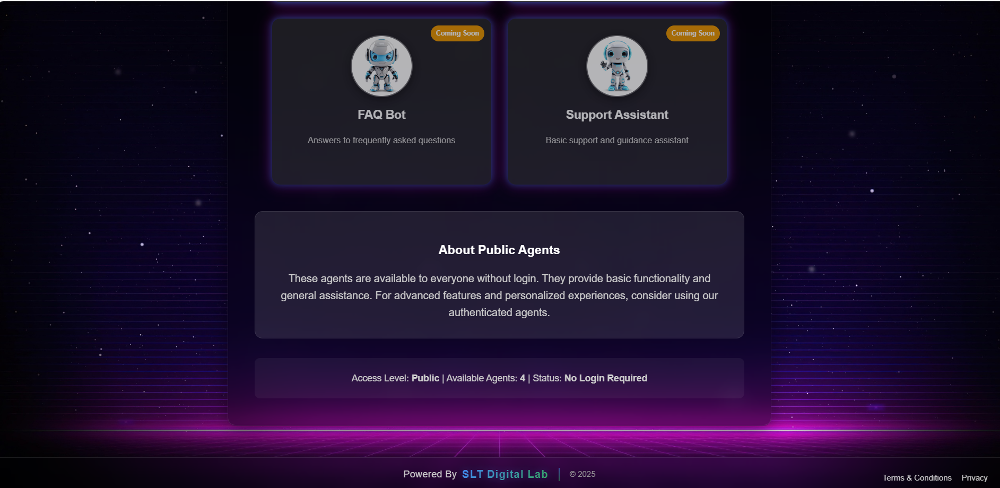

## Public Agents Manual

This section provides guidance for users accessing **Public Agents** in the Agent Store platform. These agents are accessible without signing in and are designed to provide general assistance.

---
- Visit the Agent Store at: `https://aisleaiagents.sltdigitallab.lk`

### Accessing Public Agents

- From the home page, click on the **"Public Agents"**.

**Step-01**  

  

---

### Public Agent Dashboard

- The dashboard displays 4 agents:
  1. **Innospace Assistant** *(Available)*
  2. **EKB Agent** *(Available)*
  3. **FAQ Bot** *(Coming Soon)*
  4. **Support Assistant** *(Coming Soon)*

- Click on the agent card to interact with the assistant.

**Step-02**  

  

---

### Interacting with Innospace Assistant

- Once clicked, the chat interface will open.
- Type your query into the chat box.
- You can ask anything from general information, how-to guides, or SLT-related queries.

**Step-03**  

  

---

### Interacting with EKB Agent

- Once clicked, the chat interface for EKB Agent will open.

- Type your query into the chat box related to enterprise knowledge, business documents, or internal support.

**Step-04**  

  

---

## No Login Required

- Public agents are designed for ease of use and require **no registration or login**.
- Users can start interacting instantly without providing credentials.

---

## Coming Soon Agents

- The following agents are under development and will be available in future versions:
  - **FAQ Bot**
  - **Support Assistant**

  

---